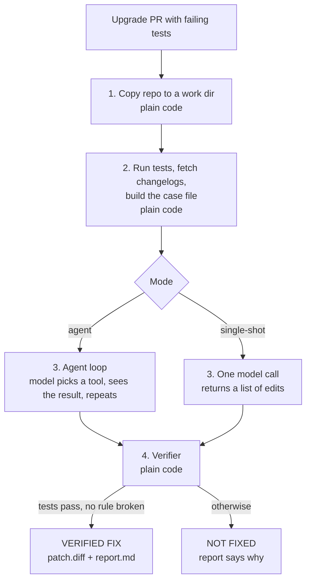

# greenbump

An AI agent that fixes Python code after a dependency upgrade breaks it. It works on a throwaway
copy of the repository, plain code decides whether the result counts, and a human reviews the patch.

Renovate and Dependabot are good at opening "bump X from 1.x to 2.x" pull requests. When the bump
is a new major version the tests often go red, because the library renamed or removed something.
Then a person has to read the error, dig through the changelog, find every place the old API is
used, fix it and retry. greenbump tries to do that loop for you and hands back a patch.

> **Status: working prototype.** On the first benchmark, using a small local model
> (`qwen2.5:7b` through Ollama), the agent produced verified fixes for **2 of 6** real breaking
> upgrades and the single-shot baseline fixed **0 of 6**. The failures are reported too, with
> reasons, because the harness exists to find out rather than to assume.

## Contents

- [Is this really an agent?](#is-this-really-an-agent)
- [How it works](#how-it-works)
- [Tools the agent can call](#tools-the-agent-can-call)
- [Guardrails](#guardrails-the-agent-will-try-to-cheat)
- [Quick start](#quick-start)
- [The eval harness](#the-eval-harness)
- [Results](#results)
- [What I learned building it](#what-i-learned-building-it)
- [Security model](#security-model)
- [Project layout](#project-layout)
- [Limitations and roadmap](#limitations-and-roadmap)
- [Development](#development)

## Is this really an agent?

Yes, but only the middle part. An agent is a program where a language model decides **what to do
next**. It calls a tool, looks at the result, and picks the next step, until the goal is met or
a budget runs out. A script is different because its author fixed every step in advance.

greenbump uses each where it fits:

| Part | Who decides the steps | Why |
| --- | --- | --- |
| Copy the repo, run tests, fetch changelogs, build the case file | Plain code | Deterministic, testable, no judgement needed |
| Read errors, search, edit, retest, decide when it is done | **The model (the agent loop)** | Every library breaks differently, so you can't write the if/else in advance |
| Decide whether the result counts as a fix | Plain code | The model saying "done" proves nothing |

There is also a **single-shot** mode: one model call, no tools, no retries. That is a workflow,
not an agent. It exists as a baseline so the eval can measure whether the agent loop earns its
extra cost.

## How it works



Step by step:

1. **Copy.** The repository is copied into `.greenbump/runs/<time>/work`. Virtualenvs, `.git` and
   caches are skipped. Your original files are never edited.
2. **Collect context (no LLM).** Run the tests with the new version installed. Pull search terms
   out of the failure: removed names (`np.float_`), failed imports, exception types. Fetch the
   upstream changelog or migration guide, split it into passages and rank them with BM25. Bring
   it all together in a **case file**: what was bumped, the test output, every file that imports
   the package, and the best matching changelog passages. You can print this with
   `greenbump context` and see exactly what the model will see.
3. **Agent loop.** The model gets the case file and eight tools. Each turn it calls one tool,
   for example `search_changelog("url_quote")`, then `edit_file(...)`, then `run_tests()`.
   Every test run reports the new errors and, alongside them, the changelog passages for those
   errors, because fixing one import error usually reveals the next one. The loop ends when the
   model calls `finish` (only accepted if the tests really pass), calls `give_up`, or runs out
   of steps or time.
4. **Verify (no LLM).** Rerun the full suite from a clean state, then check the whole diff
   against the guardrails below. Only then does it count as a fix.
5. **Output.** `patch.diff`, a readable `report.md`, `result.json` and `audit.jsonl`, which has
   every model reply and every tool call with its result.

Example of the loop, condensed from the verified `flask-v3` run in
[evals/results](evals/results/20261112-215832-ollama-qwen2.5-7b/flask-v3/agent/audit.jsonl):

```text
MODEL 1  search_changelog("Importing escape and Markup from flask is deprecated")
  TOOL   <untrusted source=".../flask/main/CHANGES.rst#L208">
         Importing escape and Markup from flask is deprecated. Import them directly from markupsafe ...
MODEL 3  edit_file(old="from flask import Flask, Markup, escape, request",
                   new="from flask import Flask, escape, request\nfrom markupsafe import Markup")
  TOOL   OK: replaced 1 occurrence(s) in webapp/app.py. The file now reads: ...
MODEL 4  run_tests()
  TOOL   Result: 1 error. E ImportError: cannot import name 'escape' from 'flask' ...
  ...    (escape moved to markupsafe, url_quote replaced with urllib.parse.quote)
MODEL 16 finish("Updated the import statements to use escape from markupsafe and replaced
                 url_quote with quote from urllib.parse.")
```

## Tools the agent can call

This list is the agent's entire reach. There is no shell tool.

| Tool | What it does | Risk |
| --- | --- | --- |
| `list_files` | List Python files in the work copy | Read only |
| `read_file(path, start_line, end_line)` | Read a file with line numbers | Read only, path confined to the work copy |
| `search_code(text)` | Plain-text search across Python files | Read only |
| `search_changelog(query)` | BM25 search over the fetched changelogs | Read only, results wrapped in `<untrusted>` |
| `edit_file(path, old_text, new_text, replace_all)` | Exact search and replace; shows the edited lines, or the closest real lines when the text is not found | Writes to the work copy only, guardrails run first, invalid Python is rolled back |
| `run_tests()` | Run pytest and show results plus matching changelog passages | Executes code in a child process with a scrubbed environment |
| `finish(summary)` | Claim success | Refused unless the tests actually pass |
| `give_up(reason)` | Stop and explain | Ends the loop |

## Guardrails (the agent will try to cheat)

A model under pressure to make tests pass will take shortcuts. Every rule compares the file
before and after, so something already in the code isn't blamed on the agent.

| Shortcut | How it is caught |
| --- | --- |
| Pin the dependency back to the old version | `requirements*.txt`, `constraints*.txt`, `pyproject.toml`, `setup.*`, lock files are protected |
| Edit CI or test configuration | `.github/`, `pytest.ini`, `tox.ini`, `conftest.py`, `noxfile.py`, `Makefile` are protected |
| Skip or xfail failing tests | New `pytest.skip`, `pytest.mark.skip/skipif/xfail`, `importorskip`, `unittest.skip` |
| Delete tests or assertions | AST count of test functions and asserts (including `pytest.raises`) must not drop |
| Silence warnings or errors | New `filterwarnings`, `warnings.simplefilter`, `catch_warnings`, bare `except:` |
| Hide problems from linters | New `# type: ignore`, `# noqa`, `# pragma: no cover` |
| Patch the library at runtime | New assignments like `np.float_ = np.float64` to any name bound to the upgraded package |
| Reach the network or a shell | New `subprocess`, `os.system`, `socket`, `urllib.request`, `requests.get`, `httpx`, ... |
| Load code dynamically | New `eval(`, `exec(`, `__import__`, `importlib`, `sys.modules`, `setattr(` |
| Huge rewrites | At most 10 files and 200 changed lines (configurable) |
| Create or delete files | Not allowed |

Guardrails run twice: on each `edit_file` call, so the model gets told and the edit is rolled
back, and again by the verifier over the final diff.

## Quick start

Requirements: Python 3.11+, and [Ollama](https://ollama.com) for a local model (nothing leaves
your machine), or any OpenAI-compatible endpoint.

```bash
git clone https://github.com/moheedinamdar/greenbump.git
cd greenbump
python3 -m venv .venv
.venv/bin/pip install -e .
source .venv/bin/activate   # puts the `greenbump` command on PATH

ollama pull qwen2.5:7b      # or any model with tool calling
```

### See what the model would see (Phase 1, no LLM)

```bash
greenbump context --repo path/to/your/repo --bump pydantic:1.10.27:2.14.3 \
  --python path/to/your/repo/.venv/bin/python
```

`--python` must be an interpreter that already has the **new** version installed (by default
greenbump looks for `REPO/.venv/bin/python`). Changelogs are discovered through PyPI, or pass
`--changelog-url` one or more times.

### Fix a repository

```bash
greenbump fix --repo path/to/your/repo --bump pydantic:1.10.27:2.14.3
greenbump fix --repo path/to/your/repo --bump pydantic:2.14.3 --mode single-shot
```

Output goes to `.greenbump/runs/<time>/`: `patch.diff`, `report.md`, `result.json`, `audit.jsonl`
and the work copy. Exit code 0 means a verified fix, 1 means not fixed, 2 means a usage error.

### Use a different model

```bash
export OPENAI_API_KEY=...                          # never commit this
export OPENAI_BASE_URL=https://api.openai.com/v1   # or any compatible server
greenbump fix --provider openai --model <model-name> --repo ... --bump ...
```

## The eval harness

Saying "it fixed one demo" proves nothing. `evals/cases/` holds small, real breaking upgrades.
Each case has:

- `repo/`: code written against the **old** major version, with `requirements.txt` already
  bumped to the **new** one. This is what a Renovate or Dependabot PR leaves behind.
- `solution/`: a reference fix, used only to prove the case is solvable. The model never sees it.
- `case.json`: the bump, the changelog URLs, and notes describing the breaking changes. The notes
  are documentation for humans and are never shown to the model.

| Case | Upgrade | What breaks |
| --- | --- | --- |
| `pydantic-v2` | pydantic 1.10.27 -> 2.14.3 | `Field(regex=)`, bare `@root_validator`, `Optional` no longer defaults to `None`, `.json(indent=...)` |
| `numpy-v2` | numpy 1.26.4 -> 2.5.4 | `np.float_`, `np.NaN`, `np.product`, `np.alltrue` removed |
| `flask-v3` | Flask 2.3.3 -> 3.1.3 and Werkzeug 2.3.8 -> 3.1.9 | `flask.Markup`, `flask.escape`, `werkzeug.urls.url_quote` removed |
| `sqlalchemy-v2` | SQLAlchemy 1.4.54 -> 2.1.8 | `Engine.execute`, `select([...])`, raw SQL strings; plus a trap: a naive fix silently loses writes without a commit |
| `marshmallow-v4` | marshmallow 3.26.2 -> 4.4.0 | `missing=`/`default=`, `Schema.context`, `@validates` signature |
| `pandas-v3` | pandas 1.5.3 -> 3.1.1 | `DataFrame.append`, `Series.iteritems`, and chained assignment that silently does nothing under Copy-on-Write |

### How the cases were checked

- `greenbump eval validate` proves, for every case, that the tests **fail** as shipped, **pass**
  with the reference solution, and that the reference solution itself **passes every guardrail**.
  All six pass this check.
- The pydantic, SQLAlchemy, Flask and marshmallow repos were also run against their **old**
  versions and pass there, with the expected deprecation warnings. NumPy 1.26 and pandas 1.5 have
  no wheels for Python 3.13, so those two were not run on the old version.

### Method

- Single-shot and agent get the **same case file**. The agent additionally gets tools and
  retries.
- Temperature 0 and a fixed seed. The agent samples only when the model replies without a tool
  call, to break out of repeated replies.
- Agent budget: 30 steps or 15 minutes per case. Test runs time out after 180 seconds.
- Changelogs are fetched once and cached; each result records the SHA-256 of the text it used.
- One run per case per mode, so run-to-run variance is not measured yet (`--repeats N` exists).
- **Tuning disclosure.** While building the loop I read the audit logs of trial runs on
  `flask-v3` only, and changed the prompts and tool feedback in response (see
  [What I learned](#what-i-learned-building-it)). The other five cases were never looked at
  during development, so `numpy-v2` is the cleaner of the two wins.

```bash
greenbump eval validate                         # prove every case is real
greenbump eval run                              # single-shot vs agent on every case
greenbump eval run --case flask-v3 --modes agent --repeats 3
```

Each run writes `summary.md`, `results.json` and per-case reports, patches and audit logs to
`evals/results/<time>-<model>/`.

## Results

Run [`evals/results/20261112-215832-ollama-qwen2.5-7b/`](evals/results/20261112-215832-ollama-qwen2.5-7b/summary.md):
local `qwen2.5:7b` on Ollama, Apple Silicon, Python 3.13, greenbump 0.1.0. Every report, patch
and audit log from the run is committed there.

| Mode | Verified fixes | Edits refused by guardrails | Median time | Tokens in / out (total) |
| --- | --- | --- | --- | --- |
| single-shot | **0/6** | 0 | 62 s | 17,598 / 682 |
| agent | **2/6** | 0 | 248 s | 869,321 / 16,753 |

| Case | Mode | Verified | Stopped because | Tests passing after | Steps | Tokens in / out | Time (s) |
| --- | --- | --- | --- | --- | --- | --- | --- |
| flask-v3 | single-shot | no | answered | 0/3 | 1 | 1,762 / 84 | 10 |
| flask-v3 | agent | **yes** | finish | 3/3 | 16 | 85,748 / 1,329 | 146 |
| marshmallow-v4 | single-shot | no | answered | 0/4 | 1 | 2,388 / 83 | 74 |
| marshmallow-v4 | agent | no | give_up | 0/4 | 19 | 120,618 / 2,193 | 219 |
| numpy-v2 | single-shot | no | answered | 1/5 | 1 | 3,807 / 78 | 79 |
| numpy-v2 | agent | **yes** | finish | 5/5 | 11 | 76,590 / 516 | 92 |
| pandas-v3 | single-shot | no | answered | 0/3 | 1 | 4,136 / 236 | 90 |
| pandas-v3 | agent | no | step-budget | 2/3 | 30 | 253,943 / 2,657 | 277 |
| pydantic-v2 | single-shot | no | answered | 0/7 | 1 | 2,571 / 110 | 50 |
| pydantic-v2 | agent | no | step-budget | 0/7 | 30 | 181,870 / 4,184 | 288 |
| sqlalchemy-v2 | single-shot | no | answered | 0/3 | 1 | 2,934 / 91 | 48 |
| sqlalchemy-v2 | agent | no | no-tool-call | 0/3 | 24 | 150,552 / 5,874 | 352 |

Times are end to end: copying the repo, running the tests and building the case file, not just
the model. Single-shot ran first for each case, so its time also includes the one-off download
of that case's changelogs. Measured from the audit timestamps, the single-shot model call itself
took 8 to 26 seconds; preparation took 1.8 seconds for `flask-v3` (changelogs already cached from
the trial runs) and 32 to 64 seconds for the other cases. Compare tokens, not seconds, for
single-shot.

### Reading the results

- **The agent loop is what made the difference.** Single-shot never got a case to green. It
  usually fixed the first error it could see and stopped there, because the next error only
  shows up once the first is fixed. The agent fixed `numpy-v2` (all four removed aliases) and
  `flask-v3` (`Markup` and `escape` moved to `markupsafe`, `url_quote` replaced by
  `urllib.parse.quote`). Both patches match the reference solutions.
- **It costs a lot more.** About 49 times the input tokens of single-shot. On a local model that
  is time, not money. On a paid API it would be real cost, which is why the baseline is worth
  keeping.
- **The verifier earned its place.** In `marshmallow-v4` the agent replaced `missing=` correctly
  but deleted `default=True` and dropped the `context` argument instead of migrating them. That
  changes behaviour. The tests caught it, the agent gave up, and nothing was claimed as a fix.
- **Behaviour changes without an exception are the hardest.** In `pandas-v3` the agent fixed
  `append` and `iteritems` (2 of 3 tests) but never fixed the chained assignment that
  Copy-on-Write silently ignores. It only reformatted that line.
- **Small-model failure modes.** In `sqlalchemy-v2` it invented an undefined `Session.execute`
  and then stopped calling tools altogether. In `pydantic-v2` it fixed `Field(regex=)` and ran
  out of its 30 steps with the other three breakages still open.
- **No guardrail refusals in this run.** This model didn't try the usual shortcuts (pinning,
  skipping tests). The guardrails are tested against scripted cheats in the unit tests. In
  `pandas-v3` it did edit a test file, but only quote style, which the rules allow because no
  test or assertion was removed.

The obvious next measurement is a stronger model on the same cases. The harness runs unchanged
with `--provider openai --model <name>` against any OpenAI-compatible endpoint.

## What I learned building it

These came out of reading the audit logs from trial runs. Each one changed the design.

1. **Errors show up one at a time.** Python stops at the first failed import, so the case file
   only shows the first breakage. The single-shot baseline fixed `Markup` and never knew
   `url_quote` was also gone. Fix: every `run_tests` result now carries changelog passages for
   the new errors. This is the main structural advantage an agent has over a single call.
2. **Plain BM25 over a changelog returns ancient history.** Searching `url_quote` returned
   Werkzeug 0.16 notes from 2019. Fix: passages are weighted by release. Notes newer than the old
   version count most, the same major line counts normally (that is where deprecation notices
   live), older notes count least, and entries that mention removal or deprecation get a boost.
3. **Changelogs don't name every function.** Werkzeug 3.0 just says "remove previously deprecated
   code", and the 2.3 note says "the `werkzeug.urls` module is deprecated, use `urllib.parse`".
   It never mentions `url_quote`. Fix: for `cannot import name X from M`, also search for the
   module `M`.
4. **Small models narrate instead of acting.** `qwen2.5:7b` often writes "let's run the tests"
   with no tool call, and at temperature 0 it repeats that reply word for word. Fix: tool-less
   replies are kept out of the history, the model is nudged, and retries sample at a higher
   temperature.
5. **Edits need feedback.** The model deleted `Markup` from an import without importing it from
   its new home, then wondered why things broke. Fix: `edit_file` now shows the edited lines,
   warns when a name it removed from an import is still used, and rolls back edits that make the
   file invalid Python.
6. **Test fixtures can hide the real error.** Flask returns a generic HTML "500 Internal Server
   Error" unless `app.testing = True`, so the model never saw the `NameError` underneath. The
   case fixture now sets testing mode, as Flask's docs recommend.
7. **Absolute paths leak.** pytest output carried home directory and virtualenv paths into
   prompts and saved results. All test output now has those paths swapped for `<repo>`, `<venv>`,
   `<python>` and `~`.
8. **"Not found" is not enough feedback.** The model sent `old_text="from flask import Markup"`
   17 times while the real line was `from flask import Flask, Markup, escape, request`. Fix: a
   failed match now returns the closest real lines. In the next trial the model's following edit
   was correct.
9. **Loops need a circuit breaker.** An identical failing call now gets a warning telling the
   model to change approach. Explicit defaults such as `replace_all: false` are ignored when
   comparing calls, because the model added them to otherwise identical retries.
10. **Rank before you truncate.** Changelog hints were listed in query order, so a weak 2019 match
    could push the right one out of the top three. They are now sorted by score first.

## Security model

Short version. The full detail is in [SECURITY.md](SECURITY.md).

- The original repository is never edited; the agent works on a copy.
- Tests run in a child process with a scrubbed environment (no tokens, no inherited
  `PYTHONPATH`, `HOME` set to the work copy). The model never sees an API key.
- Changelog text is untrusted input. It's wrapped in `<untrusted>` tags, the model is told never
  to follow instructions in it, and the tool list doesn't change no matter what it says.
- **This is process isolation, not a sandbox.** The upgraded library and the model's edits run
  as your user. Run greenbump in a container or VM for repositories you don't trust.

## Project layout

```text
src/greenbump/
  cli.py          context, fix, eval validate, eval run
  workspace.py    throwaway copy, confined paths, exact edits, diff
  runner.py       pytest in a child process, scrubbed env, path redaction
  changelog.py    discover, fetch, cache and BM25-search changelogs (version weighted)
  context.py      Phase 1: build the case file (no LLM)
  llm.py          Ollama and OpenAI-compatible chat with tool calling
  tools.py        the eight tools and their feedback
  agent.py        Phase 3: the agent loop, budget, nudges
  single_shot.py  Phase 2: the one-call baseline
  guardrails.py   anti-cheat rules
  verify.py       Phase 4: the final gate
  fixer.py        glue: copy, prepare, run, verify, write artifacts
  evals.py        Phase 5: case loading, venvs, validation, benchmark tables
  report.py       report.md
evals/cases/      six breaking upgrades with reference solutions
evals/results/    committed benchmark runs (summaries, patches, audit logs)
tests/            unit tests, offline, using a scripted fake model
```

## Limitations and roadmap

- [x] Phase 0: eval cases with reference solutions
- [x] Phase 1: context collector (`greenbump context`)
- [x] Phase 2: single-shot baseline
- [x] Phase 3: agent loop with tools, budgets and an audit log
- [x] Phase 4: guardrails and verifier (process isolation only)
- [x] Phase 5: eval harness and first measured results (agent 2/6, single-shot 0/6)
- [ ] Docker test runner with `--network none` (real sandbox)
- [ ] GitHub Action: run on failed Renovate/Dependabot PRs in two jobs. The fix job runs with
      read-only permissions and no secrets; a separate job posts the verified patch as a comment.
- [ ] More cases (target 20), plus cases where the right answer is `give_up` (for example a fix
      that needs a new dependency such as `pydantic-settings`)
- [ ] Repeated runs per case to measure variance; a larger model for comparison
- [ ] Python only, pytest only, POSIX only for now

## Development

```bash
python3 -m venv .venv
.venv/bin/pip install -e . -r requirements-dev.txt
.venv/bin/pytest            # offline unit tests with a scripted fake model
.venv/bin/ruff check . && .venv/bin/ruff format --check .
.venv/bin/mypy              # strict
```

## License

[MIT](LICENSE)